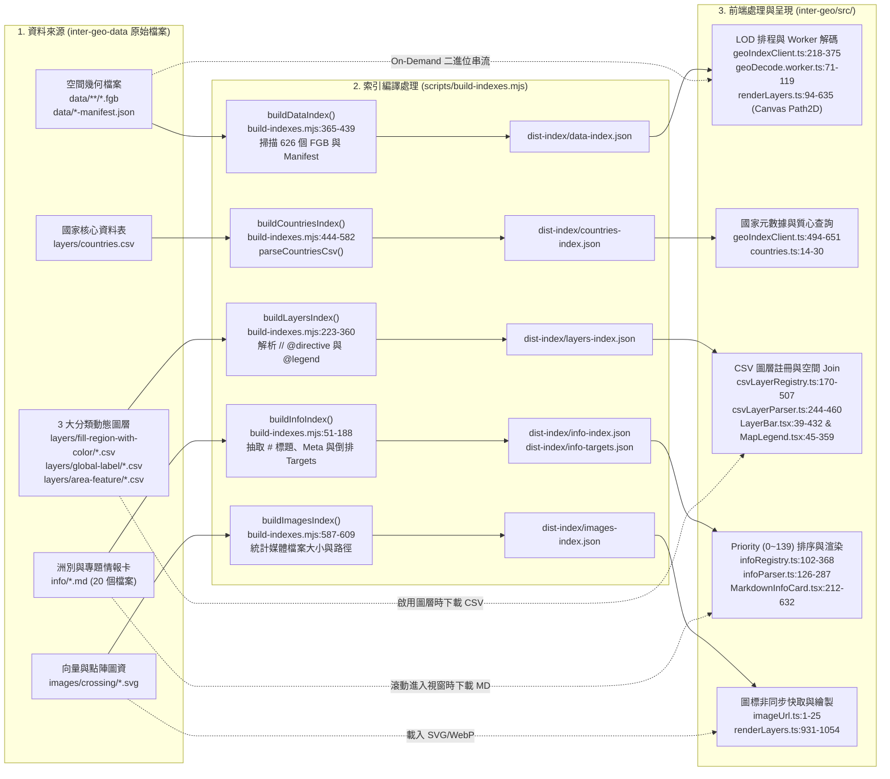

# Inter-Geo Data: 空間圖資、動態圖層與 GeoGuessr 實戰情報資料庫

`inter-geo-data` 是 Inter-Geo Web GIS 系統的集中式資料內容儲存庫。本儲存庫負責託管所有二進位空間向量邊界（FlatGeobuf `.fgb`）、國家核心元數據與 CSV 動態圖層數據庫、各大洲與專題 Markdown 實戰情報卡，以及交通標誌與地景媒體資源，並透過自動化索引編譯器（[`scripts/build-indexes.mjs`](file:///home/harvey/inter-geo-data/scripts/build-indexes.mjs)）生成輕量 JSON 索引供前端應用庫（`inter-geo`）按需即時串流。

---

## 目錄 (Table of Contents)

- [1. 儲存庫目錄導覽與檔案清單 (Repository Directory Layout)](#1-儲存庫目錄導覽與檔案清單-repository-directory-layout)
- [2. 五大資料部件：資料來源、編譯處理與前端呈現全鏈路](#2-五大資料部件資料來源編譯處理與前端呈現全鏈路)
- [3. 空間向量幾何規範 (FlatGeobuf GIS Geometry Standards)](#3-空間向量幾何規範-flatgeobuf-gis-geometry-standards)
- [4. CSV 圖層撰寫規範與 Directive 體系 (CSV Layer Directives)](#4-csv-圖層撰寫規範與-directive-體系-csv-layer-directives)
- [5. Markdown 實戰情報卡與 Street View 嵌入撰寫指南 (Info Card & Street View Guide)](#5-markdown-實戰情報卡與-street-view-嵌入撰寫指南-info-card--street-view-guide)
  - [5.1 卡片基本結構、元數據與 Priority (0~139) 階層規範](#51-卡片基本結構元數據與-priority-0139-階層規範)
  - [5.2 Google Maps 與 Street View 街景嵌入語法（支援最簡縮寫）](#52-google-maps-與-street-view-街景嵌入語法支援最簡縮寫)
  - [5.3 Dev Mode (?dev=true) 街景即時微調器工作流](#53-dev-mode-devtrue-街景即時微調器工作流)
- [6. 媒體資源管理規範 (Media Assets Guidelines)](#6-媒體資源管理規範-media-assets-guidelines)
- [7. 自動化索引編譯與 CI/CD 發布流程 (Index Generation & CI/CD)](#7-自動化索引編譯與-cicd-發布流程-index-generation--cicd)

---

## 1. 儲存庫目錄導覽與檔案清單 (Repository Directory Layout)

```text
inter-geo-data/
├── data/                          # 二進位空間向量多邊形與線段 (FlatGeobuf, 共 626 個 .fgb 檔)
│   ├── COUNTRY.fgb                # L1 全球國家輪廓 (177+ 國)
│   ├── {iso2}.fgb                 # L2 一級行政區多邊形 (91 國，如 JP.fgb, US.fgb)
│   ├── {iso2}/{sub}.fgb           # L3+ 二級/三級行政區微型分區包 (276+ 個，如 JP/01.fgb, US/CA.fgb)
│   ├── {iso2}-roads.fgb           # 各國主要公路網線段 (如 US-roads.fgb, JP-roads.fgb)
│   ├── TW-powerpoles.fgb          # 台灣電力座標網格多邊形
│   ├── l2-manifest.json           # L2 國家清單、單位名稱與 BBox 定義
│   ├── l3-manifest.json           # L3 分區映射、父層代碼與檔案路徑清單
│   └── roads-manifest.json        # 各國道路網檔案與道路數量清單
├── layers/                        # 國家基礎表與 CSV 動態圖層數據庫 (共 29 個圖層)
│   ├── countries.csv              # 180 國核心基礎元數據與質心座標 (ISO-2, 國旗, 覆蓋率, 靠左/靠右)
│   ├── fill-region-with-color/    # [單選 Radio] 2D 區塊著色與雙色道路標線圖層
│   ├── global-label/              # [複選 Checkbox] 全域文字/徽章標籤圖層 (國旗, 電話國碼, 頂級網域等)
│   └── area-feature/              # [複選 Checkbox] 區域特徵圖層 (公路網, 電力網格, 歐洲行人標誌, 境內區碼)
├── info/                          # GeoGuessr 實戰情報卡 (共 20 個 Markdown 檔，401 張情報卡)
│   ├── europe.md                  # 歐洲各國在地語言習慣與街頭實戰情資 (41 張卡)
│   ├── asia.md                    # 亞洲各國在地語言習慣與街頭實戰情資 (25 張卡)
│   ├── latin-america.md           # 拉丁美洲各國在地語言習慣與區域比較情資 (21 張卡)
│   ├── north-america.md           # 北美(美/加/夏威夷/魁北克)在地語言與路標情資 (4 張卡)
│   ├── africa.md                  # 非洲各國在地語言習慣與街頭招牌情資 (12 張卡)
│   ├── oceania.md                 # 大洋洲(澳洲/紐西蘭)在地語言與雙語路標情資 (2 張卡)
│   ├── countries.md               # 91 個街景覆蓋國家的基礎速查總覽卡 (priority: 1)
│   ├── japan.md                   # 日本 47 都道府縣行政區與北海道雪道文化專題 (48 張卡)
│   ├── india-states.md            # 印度 36 邦與聯邦屬地專題卡 (36 張卡)
│   ├── pedestrian-crossing.md     # 歐洲與中亞 32 組行人穿越道標誌圖鑑 (32 張卡)
│   ├── eu-bollard.md              # 歐洲各國公路護柱 (Bollards) 辨識圖鑑 (23 張卡)
│   ├── car-meta.md                # 全球特殊街景拍攝車裝備 (涉水喉/黑膠帶/警車/低視角) (10 張卡)
│   ├── highways.md                # 美/歐/德/日/台/英/法 主幹公路網編號法則 (8 張卡)
│   ├── grok-gen.md                # 各國電線桿、地形分區与進階環境辨識 (37 張卡)
│   ├── local-admin.md             # 美/法/德/義/西/波 二級地方行政區車牌與公路規則 (6 張卡)
│   ├── taiwan-grid.md             # 台灣電線桿電力圖號座標網格專題
│   ├── russia.md                  # 俄羅斯遠東右駕二手車現象專題
│   ├── india.md / note.md         # 印度文字補充與哈薩克街景隨筆
│   └── test.md                    # Google Maps 嵌入語法展示測試卡
├── images/                        # 媒體圖檔資源 (SVG, WebP, PNG)
│   └── crossing/                  # 各國行人穿越道標誌向量圖 (de.svg, es.svg, kz.svg 等 46 個檔案)
├── scripts/
│   └── build-indexes.mjs          # Node.js 自動化索引編譯器 (生成 dist-index/*.json)
└── dist-index/                    # 編譯輸出之 7 個輕量化 JSON 索引 (由 CI 自動發布至 index 分支)
```

---

## 2. 五大資料部件：資料來源、編譯處理與前端呈現全鏈路

下圖完整展示 `inter-geo-data` 的 5 大原始資料部件如何經由 [`scripts/build-indexes.mjs`](file:///home/harvey/inter-geo-data/scripts/build-indexes.mjs) 編譯為 `dist-index/*.json`，並由前端 `inter-geo` 載入、處理與渲染（節點均標註確切之 `file:line`）：



### 各部件資料流向對照總表

| 資料部件 | 原始資料來源 (`inter-geo-data`) | 索引編譯器處理 (`build-indexes.mjs`) | 編譯產物 (`dist-index/`) | 前端載入與解析 (`inter-geo/src/`) | 最終呈現方式 |
| --- | --- | --- | --- | --- | --- |
| **1. 空間向量幾何** | `data/COUNTRY.fgb`<br>`data/{iso2}.fgb`<br>`data/{iso2}/{sub}.fgb`<br>`data/{iso2}-roads.fgb`<br>`data/*-manifest.json` | [`buildDataIndex()` (L365-L439)](file:///home/harvey/inter-geo-data/scripts/build-indexes.mjs#L365-L439) 遞迴掃描 `data/` 並合併 L2/L3/Roads Manifest | `data-index.json` | [`geoIndexClient.ts:218`](file:///home/harvey/inter-geo/src/data/geoIndexClient.ts#L218) 快取索引；[`WorldMap.tsx:1089`](file:///home/harvey/inter-geo/src/components/WorldMap.tsx#L1089) 判定可視範圍後交由 [`geoDecode.worker.ts:71`](file:///home/harvey/inter-geo/src/map/geoDecode.worker.ts#L71) 解碼為 `Path2D` | [`renderLayers.ts:94`](file:///home/harvey/inter-geo/src/map/render/renderLayers.ts#L94) Canvas 2D 多邊形與公路線段光柵化；[`L3ChildPicker.tsx:16`](file:///home/harvey/inter-geo/src/components/L3ChildPicker.tsx#L16) 下轄市區町村選單 |
| **2. 國家基礎資料** | `layers/countries.csv` | [`parseCountriesCsv()` (L501-L564)](file:///home/harvey/inter-geo-data/scripts/build-indexes.mjs#L501-L564) & [`buildCountriesIndex()` (L566-L582)](file:///home/harvey/inter-geo-data/scripts/build-indexes.mjs#L566-L582) | `countries-index.json` | [`geoIndexClient.ts:494`](file:///home/harvey/inter-geo/src/data/geoIndexClient.ts#L494) 載入國家清單與質心 `[lon, lat]`；同步至 [`countries.ts:17`](file:///home/harvey/inter-geo/src/data/countries.ts#L17) | 國旗與中英文名稱顯示、全域標籤質心定位、搜尋與麵包屑導航 |
| **3. 動態 CSV 圖層** | `layers/fill-region-with-color/*.csv`<br>`layers/global-label/*.csv`<br>`layers/area-feature/*.csv` | [`buildLayersIndex()` (L223-L360)](file:///home/harvey/inter-geo-data/scripts/build-indexes.mjs#L223-L360) 依子目錄推導 `group`，解析 `// @directive` 與 `@legend` | `layers-index.json` | [`csvLayerRegistry.ts:170`](file:///home/harvey/inter-geo/src/layers/csvLayerRegistry.ts#L170) 建立圖層樹；開啟時 [`csvLayerParser.ts:244`](file:///home/harvey/inter-geo/src/layers/csvLayerParser.ts#L244) 解析資料列並由 [`assignableRegions.ts:23`](file:///home/harvey/inter-geo/src/layers/assignableRegions.ts#L23) 正規化 ID | [`LayerBar.tsx:39`](file:///home/harvey/inter-geo/src/components/LayerBar.tsx#L39) 圖層面板、[`MapLegend.tsx:45`](file:///home/harvey/inter-geo/src/map/MapLegend.tsx#L45) 動態圖例、[`renderLayers.ts`](file:///home/harvey/inter-geo/src/map/render/renderLayers.ts) 填色／雙色標線／文字膠囊 |
| **4. 實戰情報卡** | `info/*.md`（6 大洲 + 14 個專題檔） | [`buildInfoIndex()` (L51-L188)](file:///home/harvey/inter-geo-data/scripts/build-indexes.mjs#L51-L188) 拆分 `#` 段落、提取 Meta 與 `preview`，建立目標倒排映射 | `info-index.json`<br>`info-targets.json` | [`infoRegistry.ts:159`](file:///home/harvey/inter-geo/src/info/infoRegistry.ts#L159) `queryInfoStubs()` 依 `priority` (`0~139`) 升冪排序；[`infoParser.ts:267`](file:///home/harvey/inter-geo/src/info/infoParser.ts#L267) 解析 Markdown 全文 | [`CountryDetailPanel.tsx:26`](file:///home/harvey/inter-geo/src/components/CountryDetailPanel.tsx#L26) 側邊抽屜、[`MarkdownInfoCard.tsx:212`](file:///home/harvey/inter-geo/src/components/MarkdownInfoCard.tsx#L212)、[`MapTooltip.tsx:160`](file:///home/harvey/inter-geo/src/map/MapTooltip.tsx#L160) 懸停摘要 |
| **5. 媒體與內嵌街景** | `images/crossing/*.svg`<br>`info/*.md` 內嵌之 `` | [`buildImagesIndex()` (L587-L609)](file:///home/harvey/inter-geo-data/scripts/build-indexes.mjs#L587-L609) 建立媒體清單 | `images-index.json` | [`imageUrl.ts:1`](file:///home/harvey/inter-geo/src/info/imageUrl.ts#L1) 解析圖片 URL；[`googleMapsEmbed.ts:76`](file:///home/harvey/inter-geo/src/utils/googleMapsEmbed.ts#L76) 解析街景參數與裁切範圍 | [`renderLayers.ts:931`](file:///home/harvey/inter-geo/src/map/render/renderLayers.ts#L931) 地圖號誌圖示、[`GoogleMapsEmbed.tsx:79`](file:///home/harvey/inter-geo/src/components/GoogleMapsEmbed.tsx#L79) 互動街景與 Dev 微調器 |

---

## 3. 空間向量幾何規範 (FlatGeobuf GIS Geometry Standards)

所有空間邊界均採用 [FlatGeobuf](https://flatgeobuf.org/) (`.fgb`) 二進位格式存放，支援零拷貝串流反序列化。

| 階層 / 類型 | 檔案路徑格式 | 關聯 Manifest | 說明與屬性規範 |
| --- | --- | --- | --- |
| **L1 根幾何** | `data/COUNTRY.fgb` | — | 世界底圖與 177+ 國外框。要素包含 `id` (ISO-2)、`name`、`bbox`。 |
| **L2 一級行政區** | `data/{iso2}.fgb` | `data/l2-manifest.json` | 91 國省、州、都道府縣邊界（如 `data/JP.fgb`、`data/US.fgb`）。要素包含 `code`、`name`、`name_zh`。 |
| **L3+ 細部階層** | `data/{iso2}/{sub}.fgb` | `data/l3-manifest.json` | 276+ 個二級／三級行政區分區包（如日本北海道市町村 `data/JP/01.fgb`、美國加州郡級 `data/US/CA.fgb`）。 |
| **道路網幾何** | `data/{iso2}-roads.fgb` | `data/roads-manifest.json` | 1D 公路線段幾何（如 `data/US-roads.fgb`、`data/TW-roads.fgb`）。要素包含 `name`、`ref`、`class`。 |
| **特殊網格幾何** | `data/TW-powerpoles.fgb` | — | 台灣電力公司電線桿圖號座標網格（`A` ~ `Z` 分區多邊形）。 |

---

## 4. CSV 圖層撰寫規範與 Directive 體系 (CSV Layer Directives)

圖層統一以 CSV 格式編寫於 `layers/` 旗下 3 大分類子目錄。編譯腳本 [`build-indexes.mjs:223-360`](file:///home/harvey/inter-geo-data/scripts/build-indexes.mjs#L223-L360) 會直接依據所在的資料夾名稱自動推導圖層群組（`fill-region-with-color/` $\rightarrow$ `fill-region`、`global-label/` $\rightarrow$ `global-label`、`area-feature/` $\rightarrow$ `area-feature`）。

### CSV 標頭範例

```csv
// @id: driving-side
// @nameZh: 行駛方向
// @nameEn: Driving Side
// @shortBadge: 🚦 方向
// @type: FillWithColor
// @default-color: #1e2430
// @order: 8
// @descriptionZh: 全球各國道路通行方向（靠左行駛 #f59e0b 與靠右行駛 #3b82f6）制度分布
// @legend: #f59e0b: 靠左行駛 (Left-hand Drive)
// @legend: #3b82f6: 靠右行駛 (Right-hand Drive)
// @legend: #1e2430: 無街景或未收錄
regionId,value,label
JP,#f59e0b,靠左
GB,#f59e0b,靠左
TW,#3b82f6,靠右
US,#3b82f6,靠右
```

### Directive 標頭字典（由 [`csvLayerParser.ts:244-345`](file:///home/harvey/inter-geo/src/layers/csvLayerParser.ts#L244-L345) 與 [`build-indexes.mjs:247-315`](file:///home/harvey/inter-geo-data/scripts/build-indexes.mjs#L247-L315) 解析）

| 標頭指令 | 必要性 | 說明 | 範例 |
| --- | :---: | --- | --- |
| `// @id:` | **必要** | 圖層全域唯一識別碼（通常與檔名一致） | `// @id: road-markings` |
| `// @nameZh:` | **必要** | 前端 `LayerBar` 與 `MapLegend` 顯示之繁體中文名稱 | `// @nameZh: 道路標線顏色` |
| `// @nameEn:` | 建議 | 英文副標題名稱 | `// @nameEn: Road Markings` |
| `// @shortBadge:` | 建議 | 頂部與圖例顯示之簡短 Emoji 膠囊 | `// @shortBadge: 🛣️ 標線` |
| `// @type:` | **必要** | 渲染器類型：`FillWithColor`（填色/雙色標線/1D路網）、`TextWithStyle`（文字徽章）、`Image`（SVG圖標） | `// @type: FillWithColor` |
| `// @fgb:` | 選填 | 綁定外部專屬 `.fgb` 空間檔案（由 [`extObjectLoader.ts:30`](file:///home/harvey/inter-geo/src/layers/extObjectLoader.ts#L30) 載入） | `// @fgb: data/US-roads.fgb` |
| `// @goto:` | 選填 | 啟用圖層時相機自動飛往之視角（無 `@goto` 則保持當前視角不移動） | `// @goto: lat=39.5&lon=-98.35&ratio=0.8` |
| `// @default-color:` | 選填 | 未命中地區之預設填色 | `// @default-color: #1e2430` |
| `// @defaultStyle:` | 選填 | `TextWithStyle` 圖層之預設樣式（`badge`、`grid-letter`、`plain` 或自訂 CSS） | `// @defaultStyle: badge` |
| `// @legend:` | 選填 | 可重複宣告多行，格式為 `#色碼: 說明` 或 `#邊線:#中線: 說明`，由 [`MapLegend.tsx`](file:///home/harvey/inter-geo/src/map/MapLegend.tsx) 自動渲染 | `// @legend: #f1f5f9:#f59e0b: 白邊黃中` |
| `// @order:` | 選填 | 同分類群組內之顯示排序權重（數字越小越靠前） | `// @order: 15` |

---

## 5. Markdown 實戰情報卡與 Street View 嵌入撰寫指南 (Info Card & Street View Guide)

### 5.1 卡片基本結構、元數據與 Priority (0~139) 階層規範

所有情報卡均存放在 `info/*.md`，每個一級標題 `# 標題` 代表一張獨立卡片：

```markdown
# 道民的雪道尊嚴與「武士之慈悲」
- id: hokkaido-snow-pride
- targets: JP::01
- icon: ❄️
- accent: #0284c7
- tags: Culture, Trivia, Geoguessr
- priority: 26

- **【武士的慈悲？】**
  - 在北海道嚴冬街頭，路面常凍結成高危險的鏡面壓雪或黑冰（Black Ice）...
```

#### `priority` 排序權重階層規範（`0 ~ 139` 升冪排序，數字越小越優先）

前端 [`infoRegistry.ts:307-312`](file:///home/harvey/inter-geo/src/info/infoRegistry.ts#L307-L312) 嚴格以 `priority` 進行升冪排序（未填寫時預設為 `140`）。為了確保**單一國家／單一行政區的專屬卡片永遠排在上方，而多國並列比較的卡片排在下方**，全庫遵循以下階層配置：

| `priority` 區間 | 卡片層級定位 | 代表檔案與範例 |
| :---: | --- | --- |
| **`0 ~ 1`** | **國家核心總覽與單國高優先標誌** | `countries.md` (`1`)、`pedestrian-crossing.md` 單一國家行人標誌 (`1`) |
| **`5`** | **一級／二級行政區基礎制度卡** | `india-states.md` (`5`)、`local-admin.md` (`5`) |
| **`20`** | **單一國家在地語言與街頭文字習慣** | `europe.md`、`asia.md`、`latin-america.md`、`north-america.md`、`africa.md`、`oceania.md` 單國語言卡 (`20`) |
| **`25 ~ 26`** | **日本都道府縣單一行政區與地方文化專題** | `japan.md` 各都道府縣 (`25`)、北海道雪道文化專題 (`26`) |
| **`35 ~ 40`** | **單一國家專屬特徵（街景車、護柱、電線桿、公路）** | `car-meta.md` 單國街景車 (`35`)、`peru-chifa` / `brazil-satellite-dishes` (`35`)、`eu-bollard.md` / `grok-gen.md` / `highways.md` 單國特徵 (`40`) |
| **`100`** | **雙國／跨區並列語言與共用行人標誌** | 關西方言 (`JP::25~28`)、東北與北海道方言 (`JP::01,02,04`)、海灣阿拉伯 (`AE,QA,OM,KW`)、阿爾巴尼亞與科索沃 (`AL,XK`)、雙國共用行人標誌 (`100`) |
| **`110 ~ 120`** | **2～7 國跨國比較特徵卡** | 美澳模糊畫質比較 (`110~115`)、德盧/捷斯/斯蒙護柱 (`110`)、日瑞斯低視角鏡頭 (`120`)、波羅的海三國護柱 (`120`)、南美鄰國對比 (`110~120`)、歐洲跨國 E 級公路 (`120`) |
| **`139`** | **洲際／全球多國大總覽** | `car-meta-overview` 14 國街景車總覽 (`139`)、`south-america-overview` 南美 12 國總覽 (`139`)、`european-bollards` 全歐護柱總覽 (`139`) |

---

### 5.2 Google Maps 與 Street View 街景嵌入語法（支援最簡縮寫）

在 Markdown 條目中可使用圖片語法 `` 嵌入互動式 Google Street View 或地圖，由 [`googleMapsEmbed.ts:76-577`](file:///home/harvey/inter-geo/src/utils/googleMapsEmbed.ts#L76-L577) 與 [`GoogleMapsEmbed.tsx:79-918`](file:///home/harvey/inter-geo/src/components/GoogleMapsEmbed.tsx#L79-L918) 負責解析與渲染。

#### 推薦最簡語法範例

```markdown
<!-- 最簡街景語法：sv (streetview)、lock (預設鎖定)、h (水平角)、p (俯仰角)、fov (視野 10~100) -->
- 

<!-- 附帶自訂四邊裁切：t (上)、r (右)、b (下)、l (左) 或 v (垂直上下)、h (水平左右) -->
- 

<!-- 直接貼上 Google Maps 瀏覽器完整網址（自動萃取經緯度與 h/t/y 視角參數） -->
- 
```

#### 支援選項參數與最簡縮寫對照表（[`googleMapsEmbed.ts:155-430`](file:///home/harvey/inter-geo/src/utils/googleMapsEmbed.ts#L155-L430)）

| 參數類別 | 最簡縮寫 | 完整寫法與別名 | 範圍與預設行為說明 |
| --- | :---: | --- | --- |
| **模式 (Mode)** | `sv` | `streetview`、`street-view`、`pano` | 全景街景模式（座標預設啟用）。 |
| | `map` | `view`、`gmap`、`googlemap` | 2D 俯視地圖模式。 |
| | `place` | `landmark` / `search` / `directions` | 地標釘選、關鍵字搜尋或路線模式。 |
| **視窗鎖定 (Lock)** | `lock` | `locked`、`static`、`freeze` | **預設鎖定防誤觸**：鎖定時 `iframe` 設為 `pointer-events: none` 並覆蓋 `touch-action: pan-y` 觸控穿透層（[`GoogleMapsEmbed.tsx:579, 608`](file:///home/harvey/inter-geo/src/components/GoogleMapsEmbed.tsx#L579)），在手機或滑鼠滾輪上可順暢上下滑動整張資訊卡；點擊右上角純圖標 `🔒` 按鈕可隨時解鎖 360° 互動。 |
| **水平方位角** | `h=<角度>` | `heading=<角度>`、`head=<角度>` | `0` ~ `360` 度（支援 `0.5°` 精度，如 `h=348.5`）。 |
| **垂直俯仰角** | `p=<角度>` | `pitch=<角度>` | `-90` ~ `90` 度（`0` 為平視，正數仰視，負數俯視，支援 `0.5°` 精度）。 |
| **視野 / 縮放** | `fov=<角度>` | `fov=10` ~ `fov=100` | 水平視野範圍 `10°`（放到最大特寫）至 `100°`（最廣角，預設 `90°`）。在微調面板中反向映射為直覺的「**縮放 (Zoom) `0 ~ 90`**」（`zoom = 100 - fov`）。 |
| **純淨裁切** | 預設自動啟用 | `crop=67,58,50,0` | 預設自動裁除上方 67px（標題卡）、右側 58px（羅盤控制項）、下方 50px（版權列）、左側 0px。 |
| | `no-crop` | `uncropped`、`crop=none`、`crop=0` | 關閉裁切，顯示原始 Google Embed 介面。 |
| | `t=` / `r=` / `b=` / `l=` | `crop-t=`、`crop-r=`、`crop-b=`、`crop-l=` | 個別微調上、右、下、左裁切像素；若上下相同自動縮寫為 `v=`（`crop-v`），左右相同自動縮寫為 `crop-h=`。 |
| **畫面比例與高度** | `16:9` (預設) | `4:3`、`16:10`、`1:1`、`h=280` | 預設 16:9 隨抽屜寬度動態等比縮放；亦可以 `h=<160~600>` 指定固定像素高度。 |

---

### 5.3 Dev Mode (`?dev=true`) 街景即時微調器工作流

當在網址列加上 `&dev=true`（例如 `http://localhost:8080/inter-geo/?dev=true`）時，系統會啟用開發者模式（[`devMode.ts:9-58`](file:///home/harvey/inter-geo/src/utils/devMode.ts#L9-L58)），街景右上角會額外浮現 `🎛️` 微調純圖標按鈕（[`GoogleMapsEmbed.tsx:644-662`](file:///home/harvey/inter-geo/src/components/GoogleMapsEmbed.tsx#L644-L662)）：

1. **展開微調面板**：點擊 `🎛️` 展開滑桿面板（格式：`文字項目 ^對齊^ [-] ---bar--- [+]`）。
2. **0.5° 精準微調與反向縮放**：
   - `水平`：`0° ~ 360°`（步進 `0.5°`）
   - `垂直`：`-90° ~ 90°`（步進 `0.5°`）
   - `縮放`：`0 ~ 90`（步進 `0.5`，最低為 `0` 對應最廣角 `fov=100°`，最高 `90` 對應最大放大特寫 `fov=10°`）
   - `左裁 / 上裁 / 右裁 / 下裁`：`0px ~ 200px`（步進 `1px`）
3. **可讀寫最簡語法框与一鍵複製**：
   - 面板底部文字框會即時輸出最簡寫法（如 ``）。
   - 可直接在文字框內修改座標、貼上新的 Google Maps 網址或增減參數，按下 **`Enter`** 即刻更新上方街景畫面。
   - 點擊右側純圖標複製按鈕即可將語法複製到剪貼簿，直接貼回 `inter-geo-data/info/*.md`。

---

## 6. 媒體資源管理規範 (Media Assets Guidelines)

- **存放路徑**：一律存放在 `images/{類別}/` 目錄下（例如 `images/crossing/de.svg`）。
- **格式推薦**：標誌、徽章與幾何圖示優先採用 **SVG** 向量格式；實景照片請壓縮為 **WebP**。
- **引用方式**：於 CSV 或 Markdown 中使用 `/images/...` 根相對路徑，前端 [`imageUrl.ts`](file:///home/harvey/inter-geo/src/info/imageUrl.ts) 會自動解析為遠端或本機 `@geo-data/main/images/...` 完整網址。

---

## 7. 自動化索引編譯與 CI/CD 發布流程 (Index Generation & CI/CD)

每當新增或修改 `data/`、`layers/`、`info/` 或 `images/` 後，請在 `inter-geo-data` 根目錄執行索引編譯：

```bash
# 編譯生成 dist-index/*.json
npm run build:index
```

### 編譯產物明細 (`dist-index/`)

| 索引檔案 | 生成函式 (`scripts/build-indexes.mjs`) | 內容與前端消費者 |
| --- | --- | --- |
| `index.json` | [`main` (L614-L665)](file:///home/harvey/inter-geo-data/scripts/build-indexes.mjs#L614-L665) | 總體統計清單與生成時間戳 |
| `info-index.json` | [`buildInfoIndex()` (L51-L188)](file:///home/harvey/inter-geo-data/scripts/build-indexes.mjs#L51-L188) | 全部情報卡的 Stub 元數據清單（不含 Markdown 內文） |
| `info-targets.json` | [`buildInfoIndex()` (L157-L185)](file:///home/harvey/inter-geo-data/scripts/build-indexes.mjs#L157-L185) | 以目標代碼（如 `JP`, `JP::01`, `US-HIGHWAY`）為 Key 的倒排索引表，供 [`infoRegistry.ts:102`](file:///home/harvey/inter-geo/src/info/infoRegistry.ts#L102) $O(1)$ 查詢 |
| `layers-index.json` | [`buildLayersIndex()` (L223-L360)](file:///home/harvey/inter-geo-data/scripts/build-indexes.mjs#L223-L360) | 29 個 CSV 圖層的 Directive 元數據、群組與圖例，供 [`csvLayerRegistry.ts:170`](file:///home/harvey/inter-geo/src/layers/csvLayerRegistry.ts#L170) 註冊 |
| `data-index.json` | [`buildDataIndex()` (L365-L439)](file:///home/harvey/inter-geo-data/scripts/build-indexes.mjs#L365-L439) | 626 個 `.fgb` 檔案清單與 L2/L3/Roads Manifest，供 [`geoIndexClient.ts:218`](file:///home/harvey/inter-geo/src/data/geoIndexClient.ts#L218) 查詢 |
| `countries-index.json` | [`buildCountriesIndex()` (L566-L582)](file:///home/harvey/inter-geo-data/scripts/build-indexes.mjs#L566-L582) | 180 國核心資料與質心座標，供 [`geoIndexClient.ts:494`](file:///home/harvey/inter-geo/src/data/geoIndexClient.ts#L494) 載入 |
| `images-index.json` | [`buildImagesIndex()` (L587-L609)](file:///home/harvey/inter-geo-data/scripts/build-indexes.mjs#L587-L609) | 46 個媒體圖檔路徑清單 |
